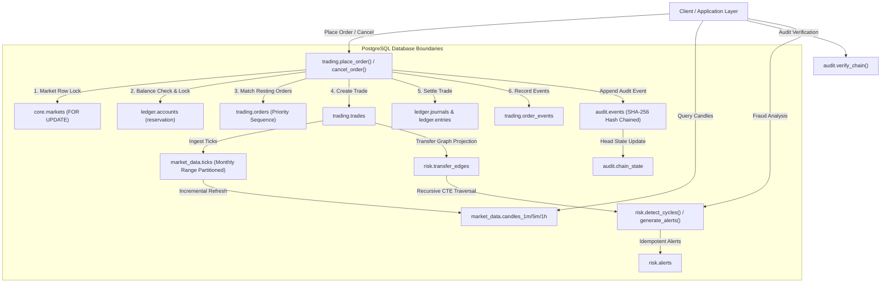

# VerityTick Architecture Specification

## 1. System Overview

VerityTick is an engineered PostgreSQL database engine simulating a high-integrity financial trading and market data platform. Core transactional logic, ledger balancing, tamper-evident audit hashing, recursive graph fraud analysis, and time-series aggregation run directly inside PostgreSQL using declarative schemas, constraints, indexes, and PL/pgSQL functions.

## 2. Namespace & Schema Separation

| Schema | Responsibility | Key Tables & Interfaces |
|---|---|---|
| `core` | Multi-tenant definitions, users, assets, market parameters, priority sequences, tenant context guard | `tenants`, `users`, `assets`, `markets`, `trading_accounts`, `assert_tenant_access()` |
| `trading` | Limit order book, execution events, trade settlements, matching engine | `orders`, `order_events`, `trades`, `place_order()`, `cancel_order()` |
| `ledger` | Double-entry accounting, immutable journals, balanced transfer legs, reconciliation | `accounts`, `journals`, `entries`, `post_transfer()`, `available_balance()`, `reconcile_balances()`, `check_conservation()` |
| `audit` | Cryptographic SHA-256 hash-chained event trail, checkpoint verification | `chain_state`, `events`, `append_event()`, `verify_chain()`, `export_checkpoint()` |
| `risk` | Materialized transfer graph, recursive cycle analysis, alert generation | `transfer_edges`, `alerts`, `detect_cycles()`, `generate_alerts()` |
| `market_data` | Time-series tick ingestion, dynamic range partitioning, OHLCV rollups | `ticks` (partitioned), `candles_1m`, `candles_5m`, `candles_1h`, `ensure_tick_partition()`, `refresh_candles()` |

## 3. Concurrency & Transactional Invariants

### Per-Market Serialization Protocol
To guarantee strict price-time priority without race conditions or skipping resting orders, `trading.place_order()` and `trading.cancel_order()` acquire an exclusive row lock on the corresponding row in `core.markets` (`SELECT ... FOR UPDATE`).
- **Granularity:** Per market (e.g., `ACME/USDX` locks independently of `BOLT/USDX`).
- **Advantage:** Guarantees deterministic atomic priority sequence assignment (`next_priority_seq`) and prevents phantom fills or crossed book anomalies without global database lock bottlenecks.
- **Settlement:** All matching executions and double-entry ledger transfers occur synchronously within the same atomic transaction. Failure at any point rolls back order placement, matching, and fund reservations entirely.
