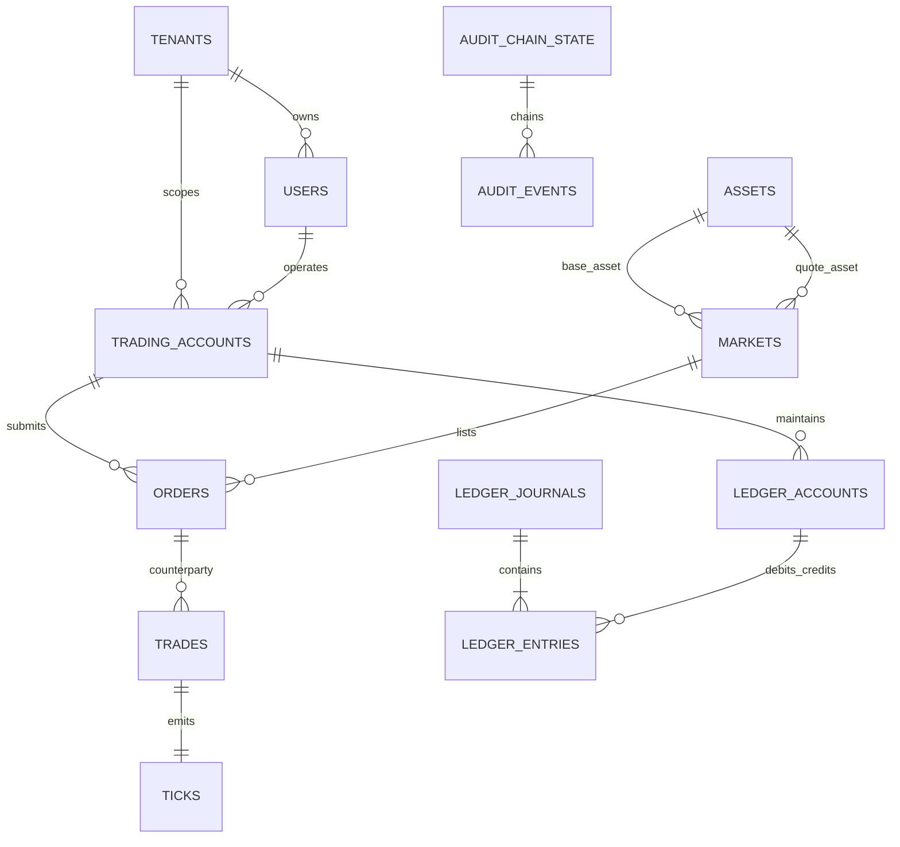
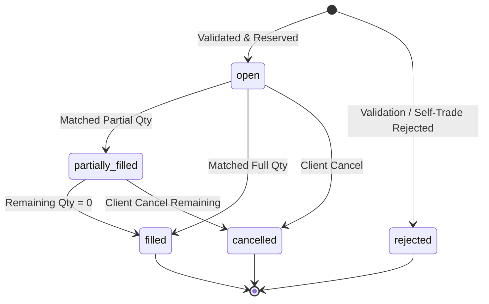

# VerityTick Data Model Specification

## 1. Relational Invariants & Precision

1. **No Floating-Point Representation:**
   All monetary amounts, order prices, quantities, and balances use `NUMERIC(30, 18)` to eliminate floating-point rounding errors and precision degradation.
2. **Deterministic Primary Identifiers:**
   UUIDs (`gen_random_uuid()`) are utilized for global identification. Sequential priority integers (`BIGINT next_priority_seq`) are atomically assigned per market for price-time ordering.
3. **Double-Entry Balance Equation:**
   Every financial transfer leg consists of balanced debit and credit movements:
   $$\sum \Delta \text{Balance}_{\text{debit}} = \sum \Delta \text{Balance}_{\text{credit}}$$
   Current balances on `ledger.accounts` are independently verifiable against historical `ledger.entries` via `ledger.reconcile_balances()` and zero-sum conservation is verifiable via `ledger.check_conservation()`.

## 2. Entity-Relationship Summary

## 3. Order Lifecycle State Machine

